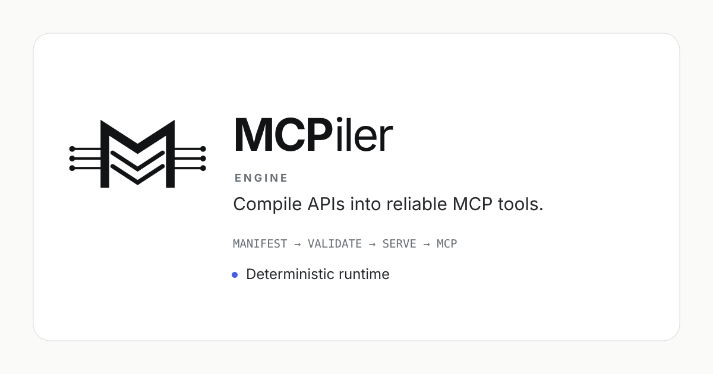

<p align="center">
  
</p>

# MCPiler Engine

MCPiler Engine turns selected operations of an existing REST API into **MCP tools**
without requiring the application itself to implement an MCP server.

```text
ChatGPT / Claude / Cursor / VS Code / MCP client
                         |
                         | MCP
                         v
                  MCPiler Engine
                         |
                         | existing REST API
                         v
                  your application
```

Write or generate a versioned **MCPiler Manifest**, run Engine, and connect a compatible MCP
client. The REST application can remain unchanged.

Engine is deliberately deterministic, explicit, fail-closed, portable and independently testable.

## Start here

The audience-oriented [documentation index](docs/README.md) maps common questions to the right
document.

**I own a product with a REST API.** Read
[`docs/getting-started.md`](docs/getting-started.md) for the complete REST → Manifest → inspect →
serve → client path. Start with one read-only endpoint and add capabilities without adding MCP code
to the application.

**I self-host an application with a good REST API.** The same guide covers running Engine beside
the application on a Docker/private network and exposing only the MCP endpoint. A concrete
[Trilium Notes example](examples/use-cases/trilium/README.md) shows the pattern.

**I already know MCPiler and need a recipe.** Use the
[end-to-end cookbook](docs/use-cases/README.md), which covers fifty representative integration
paths, or the [feature example catalogue](examples/README.md).

**I need to connect a client.** [`docs/clients.md`](docs/clients.md) contains the Engine
capability matrix and dated setup guidance for ChatGPT, Claude, Cursor, VS Code and generic MCP
clients.

**I am comparing MCPiler with alternatives.**
[`docs/alternatives.md`](docs/alternatives.md) compares MCPiler with AnythingMCP,
mcp-openapi-proxy, ContextForge, Docker MCP Gateway, MetaMCP, FastMCP and Composio, including
cases where another project is the better fit.

## Why MCPiler?

MCPiler's distinguishing choice is not merely "REST to MCP". Several projects can do that.

MCPiler makes the **versioned Manifest** the reviewed runtime contract:

```text
REST API -> author/generate/review Manifest -> deploy immutable artifact -> MCPiler Engine -> MCP
```

That model is useful when the AI-facing contract should participate in Git, PR review, CI,
environment promotion and explicit compatibility checks while the runtime remains independently
deployable without a live authoring control plane.

If your priority is instead no-code OpenAPI/SOAP/GraphQL/SQL import, a large connector catalog,
broad MCP federation or arbitrary Python MCP application logic, an alternative may be a better
starting point. See the full [comparison and decision guide](docs/alternatives.md).

## What Engine does

- Loads and validates a MCPiler Manifest.
- Serves MCP endpoints: tool catalogue, direct invocation, navigator discovery, compound tools.
- Compiles MCP arguments into exact HTTP requests: path, query, headers, cookies, bodies,
  multipart and file transfer.
- Applies credentials resolved from the environment, from files, from the active managed
  generation, or from a Manifest-declared runtime-owned slot.
- Enforces outbound containment: origin allow-lists, redirect policy, response size limits.
- Runs input and output transformations declared by the manifest.

## What Engine does not do

Engine never interprets a source API description. It does not parse OpenAPI, Postman
collections or cURL commands, does not repair or normalize contracts, and does not perform
curation or tool-budget selection. Those authoring concerns belong to MCPiler Studio, which
produces the manifest. In file mode, Engine has no control-plane runtime dependency.

A manifest, an Engine build and locally supplied secrets are sufficient to keep serving
indefinitely. Engine has no phone-home dependency. A deployment may optionally configure
[managed mode](#deployment-modes), in which Engine pulls Platform's desired immutable generation
over an authenticated channel; the Manifest contract is unchanged and standalone serving remains
fully supported without it.

## Architecture

[`docs/architecture.md`](docs/architecture.md) describes the library/host split, Manifest load
pipeline, binding seam, immutable generations, managed activation, request path, state ownership
and security boundaries. Those boundaries are backed by architecture tests rather than being
conventions documented only in prose.

## Deployment modes

Engine has exactly one desired-state authority. **File mode** (the default) serves the Manifest
bundles given with `--mount`; replacing one requires an Engine redeploy or restart. **Managed
mode** (`--mode managed`) is optional automation: Engine performs a bounded initial
synchronization before opening its listener, then long-polls Platform for the complete desired
generation and hot-reloads atomically. A candidate is validated in full before activation, a
failed candidate leaves the running generation untouched, and a Platform outage never stops the
generation already serving. [`docs/hosting.md`](docs/hosting.md) documents the settings.

## Manifests

The format reference is [`docs/manifest.md`](docs/manifest.md): every section, the diagnostic
catalogue and the versioning policy. [`docs/authoring.md`](docs/authoring.md) is the practical
write → inspect → serve guide for hand-authored Manifests. Machine-readable schemas are in
[`schemas/manifest-0.3/`](schemas/manifest-0.3/), and
[`examples/README.md`](examples/README.md) maps common authoring goals to complete examples.
Most are loaded directly by the Engine Manifest fixture corpus; the vector example additionally
ships its deterministic binary payload and generator.

A manifest is rooted at `manifest.json`, with sections either inline in that file or split
into files beneath the same bundle directory. Both shapes use the same schema and the same
loader. In file mode the CLI mounts the directory containing `manifest.json`, not the JSON file
path itself.

Manifests are designed to be authored and generated outside Studio. Integrity hashes are
optional; when present they are verified and a mismatch fails closed naming the section.
Tamper evidence is a deployment concern handled by detached signatures or container image
digests, not by a self-verifying file.

The manifest format is versioned independently of Engine. During alpha the format version
stays in the `0.x` range and Engine states its supported range when it refuses a manifest.
[`docs/compatibility.md`](docs/compatibility.md) gives the current Engine/root/section matrix and
upgrade/migration procedure. Documentation in a checkout tracks the code in that checkout; when operating a
tagged image/release, prefer the documentation from the same tag.

## Hosting

[`docs/hosting.md`](docs/hosting.md) documents mounts, host configuration, HTTP and stdio
transports, health checks, file-store commands, exit codes, shutdown behavior and the container
contract. [`docs/troubleshooting.md`](docs/troubleshooting.md) starts from operator-visible
symptoms and maps them to the relevant configuration, diagnostic and recovery path.

Official stable images are published as `ghcr.io/bartbaszt/mcpiler-engine:vA.B.C` for
`linux/amd64` and `linux/arm64`. The package is public and anonymously pullable even while the
source repository remains private. Engine's `:latest` tag means the most recent completed stable
Engine release; ordinary CI on unreleased `main` never advances it. See
[`docs/hosting.md`](docs/hosting.md#official-container-images) for digest, signature, SBOM and
provenance verification.

## File handles

A binary upstream response is written to a local store and returned as a handle rather than
inlined into a result. [`docs/file-handles.md`](docs/file-handles.md) is the contract for
that store: where the root may point and what is verified about it at startup, how storage
names are generated, what a handle record holds, the write order that decides what a failed
admission leaves behind, when a handle expires and where that is enforced, and what a scan
verdict claims.

It is Engine's only durable state by default. When runtime-owned mutable authentication is
enabled, the bounded encrypted runtime-state store described below is the only additional
durable state. Everything else Engine does is a function of the manifest it was given and the
request it was handed.

## Runtime-owned authentication state

The file store is the only durable state Engine keeps by default. A deployment serving a Manifest-declared runtime-owned mutable authentication slot, such
as a rotated OAuth refresh token, must provide the bounded encrypted store configured with
`--runtime-state-root` and `--runtime-state-key-file`. [`docs/hosting.md`](docs/hosting.md)
documents the pair, what may and may not be stored, and how a key loss is recovered.

Without that configuration, Manifests that need no durable mutable slot may still serve and report
`runtime state: memory-only`; a Manifest that declares such a slot is refused at startup rather
than being allowed to lose its replacement on restart. Static credentials, managed provider
values, access tokens, exchange sessions, challenge sessions and signing outputs are never
persisted either way.

## Brand

MCPiler Engine uses the shared MCPiler **06F — M-Gate + connected layers** visual identity. Repository, documentation and release-media assets live in [`brand/`](brand/). The **MCPiler** wordmark remains the parent brand; **Engine** is the product descriptor.

## Licensing

MCPiler Engine is licensed under Apache-2.0. See [`LICENSE`](LICENSE) and
[`NOTICE`](NOTICE). Third-party runtime dependencies keep their own licence and binary
distribution terms; [`docs/licensing.md`](docs/licensing.md) explains redistribution,
the generated third-party inventory, the JSON-Everything binary-term exception, and the
separate [trademark policy](TRADEMARKS.md).

## Status

The first stable Engine release line is `0.1.x`. The Manifest format remains independently
versioned in the `0.x` range and may still make breaking minor-version changes.

## Building

Requires the .NET SDK pinned in `global.json`.

```bash
dotnet build MCPiler.Engine.slnx -c Release
bash eng/verify-source.sh
bash eng/check-release-metadata.sh
bash eng/check-licenses.sh
```

Engine builds and tests from a standalone checkout. It must never depend on files outside
this repository.

## Contributing

See [CONTRIBUTING.md](CONTRIBUTING.md). Contributions require a Developer Certificate of
Origin sign-off (`git commit -s`). Security reports follow [SECURITY.md](SECURITY.md) and must
not be opened as public issues before private triage.

## Licence

Apache License 2.0 — see [LICENSE](LICENSE) and [NOTICE](NOTICE).
Trademark and naming rules: [TRADEMARKS.md](TRADEMARKS.md).
